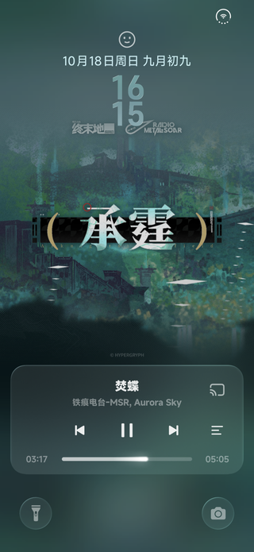
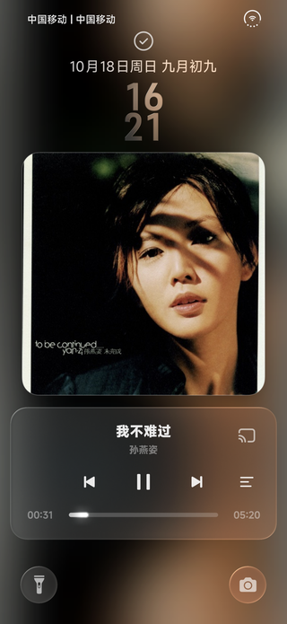
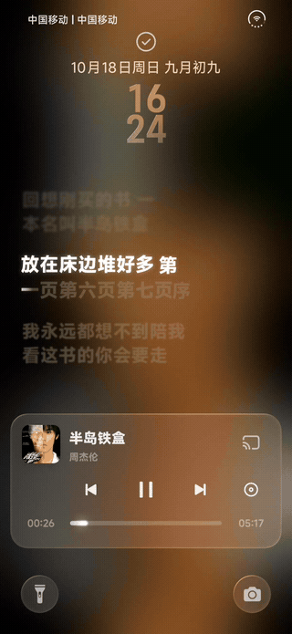

# HyperMusicCover-HyperOS3

### 适配小米澎湃 OS 3（HyperOS 3 / Android 16）的沉浸式音乐锁屏与超级岛模块

[-3DDC84?logo=android&logoColor=white)](https://www.android.com/)

---

## 简介

**HyperMusicCover-HyperOS3** 是基于上游 [zyl6932/HyperMusicCover](https://github.com/zyl6932/HyperMusicCover)（`v0.9.57+` 主线）并参考 [45072yy980/HyperMusicCover-os3-](https://github.com/45072yy980/HyperMusicCover-os3-) 深度移植与增强的 **澎湃 OS 3（HyperOS 3 / Android 16）专版 LSPosed 模块**。

实机测试环境：**小米 13 Ultra（`ishtar`）· HyperOS `3.0.306.0.WMACNXM`（Android 16 / SDK 36）· KernelSU + LSPosed（API 100+）**。

> 非官方开源修改版，与小米、Apple 均无关联。本模块不内置、不提供任何音乐或歌词内容，播放与取词均来自设备已安装的应用与服务。

---

## 澎湃 3 专版核心特性

### 1. 通透毛玻璃音乐框 & 胶囊音乐岛（澎湃 3 专属增强）
- **打通双端硬件实时模糊**：自动解除部分澎湃 3 机型/移植包默认关闭 `background_blur_status_default`（`Configuration.blur = 0`）导致的无模糊纯色底限制，同时激活 `SystemUI` 与 `MIUISystemUIPlugin` 实时背景模糊。
- **类澎湃 4 / Apple Music 通透玻璃质感**：移除原厂压灰封面的 LAB 亮度钳制层（mode `106`）与高浓度黑底，改用 **Linear Light 冰晶质感层 + 可调冷调烟熏玻璃遮罩（`0%–70%` 无级调节，默认 `22%`）+ `0.85dp` 高光玻璃细描边**，~78% 的实时模糊封面色彩自然透出。
- **场景智能分离**：
  - **锁屏音乐卡片 & 锁屏底部超级岛胶囊**：全程通透毛玻璃 + 日间浅色模式自动切换清晰白字，上滑展开/收起形变圆角实时同步。
  - **顶部状态栏胶囊音乐岛**：未展开时保持纯黑完美隐藏前置挖孔镜头；点击展开大岛时呈现半透封面染色毛玻璃。
  - **解锁后下拉通知栏**：自动恢复原厂高对比度底色与深浅色文字，确保日常阅读清晰。

### 2. 沉浸式音乐锁屏与超级岛全套移植
- **三种锁屏封面形态**：全屏专辑封面（`FastVideoEngine` 纹理/视频替换 + 景深主体自动避让）、方形悬浮封面卡片、保留原壁纸模式。
- **动态专辑封面**：支持 Apple Music 动态封面自动拉取与锁屏播放。
- **锁屏时钟折叠让位**：播放音乐时锁屏时钟平滑缩放上移，支持 AOD 息屏保持与解锁壁纸淡出过渡修复。
- **逐字锁屏歌词**：支持 LyricInfo / Lyricon / 本地内嵌歌词 / AMLL TTML / 在线歌词补充，支持主唱、和声、翻译、罗马音独立字号字重、封面取色与 HDR 高光。
- **锁屏超级岛 & 主动智能**：锁屏底部音乐胶囊岛与原生媒体卡丝滑互拉形变、通知聚合岛、高德导航与公交地铁逐站上岛、微信点单取餐码自动上岛、屏下指纹快捷菜单自定义。

---

## 安装与作用域配置

1. 确保设备运行 **HyperOS 3（Android 16）**，并已安装支持现代 `libxposed`（API 100+）的 **LSPosed** 框架。
2. 前往 [Releases](https://github.com/biancaurendell/HyperMusicCover-HyperOS3/releases) 下载最新 `HyperMusicCover-v*-release.apk` 并安装。
3. 在 LSPosed 中启用模块，勾选推荐作用域：
   - **必选核心作用域**：`系统界面 (com.android.systemui)`、`动态壁纸/超级壁纸 (com.miui.miwallpaper)`、`万象息屏 (com.miui.aod)`
   - **按需可选作用域**：Apple Music（歌词直读）、高德地图（导航/公交地铁上岛）、微信（取餐码识别）、小爱建议（地铁通勤学习）
4. 打开桌面 **HyperMusicCover** 应用，点击右上角 **重启系统界面 / 重启全部作用域** 即可生效。
5. 如需调节播放框透明度：进入 **功能 → 锁屏音乐封面 → 媒体卡片 → 通透毛玻璃播放框 / 玻璃遮罩浓度**，拖动滑块实时预览生效。

---

## 常见问题（FAQ）

<b>Q：为什么首页提示「6 个功能未安装」？正常吗？</b>

**完全正常！** 模块在澎湃 3 `SystemUI` 中共注册 28 个子特性，其中 **22 个核心功能全部成功挂载（`failed = 0`）**；另外 6 个 `no_hooks` 是 **澎湃 OS 4（Android 17）独有的液态玻璃折射时钟 API（`MiGlassCompat` 等）**，在澎湃 3 系统中本就不存在这些类，模块已做安全隔离跳过，不影响任何澎湃 3 功能与稳定性。

---

## 界面预览（上游功能示意）

<table>
  <tr>
    <td align="center"> 全屏封面</td>
    <td align="center"> 方形封面</td>
    <td align="center"> 逐字歌词</td>
  </tr>
</table>

---

## 免责声明

本模块仅供学习、研究与个人使用。模块会 Hook 系统界面与壁纸进程，请自行评估风险并做好备份；因使用本模块导致的任何系统异常或数据损失，维护者不承担责任。如有问题欢迎在本仓库 [Issues](https://github.com/biancaurendell/HyperMusicCover-HyperOS3/issues) 反馈（**请勿将澎湃 3 专版问题反馈至上游 HyperOS 4 仓库**）。

---

## 许可证与开源致谢

本项目遵循上游 **GNU Affero General Public License v3.0（AGPL-3.0）** 开源协议发布，完整协议文本见 [LICENSE](./LICENSE)，第三方组件许可证归属见 [NOTICE](./NOTICE)。

特别致谢：
- **[zyl6932/HyperMusicCover](https://github.com/zyl6932/HyperMusicCover)** — 上游原作者与全部核心架构设计
- **[45072yy980/HyperMusicCover-os3-](https://github.com/45072yy980/HyperMusicCover-os3-)** — 早期澎湃 3 适配思路参考
- [HyperNavBar](https://github.com/HyperNavBar/HyperNavBar) · [miuix](https://github.com/compose-miuix-ui/miuix) · [AndroidLiquidGlass](https://github.com/Kyant0/AndroidLiquidGlass) · [HyperChanger](https://github.com/ColdP/HyperChanger) · [HyperLyrics Enhanced](https://github.com/juren233/HyperLyrics-Enhanced) · [accompanist-lyrics-core](https://github.com/6xingyv/accompanist-lyrics-core) · [InstallerX Revived](https://github.com/wxxsfxyzm/InstallerX-Revived) · [ColorOS Live Lyrics Bridge](https://github.com/Andrea-lyz/ColorOS-Live-Lyrics-Bridge) · [AMLL](https://github.com/amll-dev/applemusic-like-lyrics) · [AutoPickupIsland](https://github.com/Maga-King/AutoPickupIsland)
